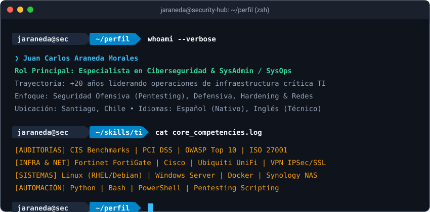

<!-- ╔══════════════════════════════════════════════════════╗ -->
<!--                    CYBERPUNK BANNER                   -->
<!-- ╚══════════════════════════════════════════════════════╝ -->

  

<!-- TERMINAL TYPING ANIMADA (SIN NOMBRES DE MODELOS) -->

  

<!-- CONTACT BADGES -->

  
  
  
  
  

---

  

---

# 🛠️ STACK TÉCNICO & CAPACIDADES OPERATIVAS

### 🟣 Inteligencia Artificial, LLMs Locales & RAG

  
  
  
  
  
  
  

### 🟢 Ciberseguridad & Auditorías

  
  
  
  
  
  
  

### 🔵 Redes & Comunicaciones

  
  
  
  
  
  

### 🟠 Servidores, Virtualización & Almacenamiento

  
  
  
  
  
  

### 🔷 Automatización & Lenguajes

  
  
  
  

---

# 📊 ACTIVIDAD GITHUB

  
  

  

---

  <b>Juan Carlos Araneda Morales</b> • <i>Santiago, Chile</i> 
  Protegiendo y operando infraestructuras críticas con IA local, rigor técnico y mejora continua.  
  

